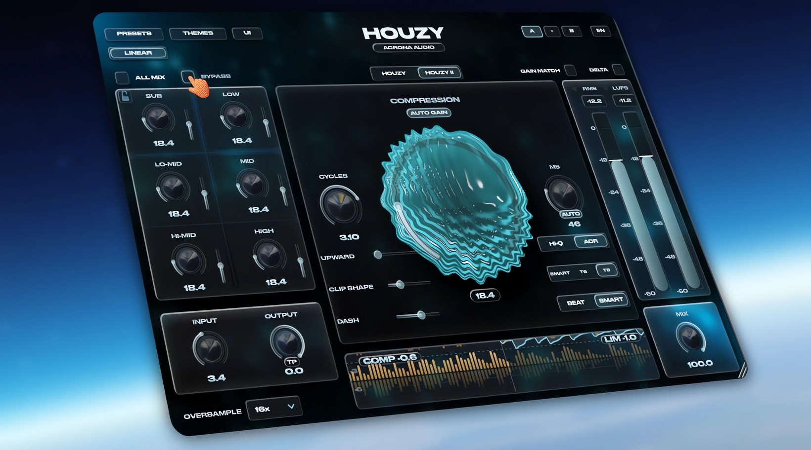
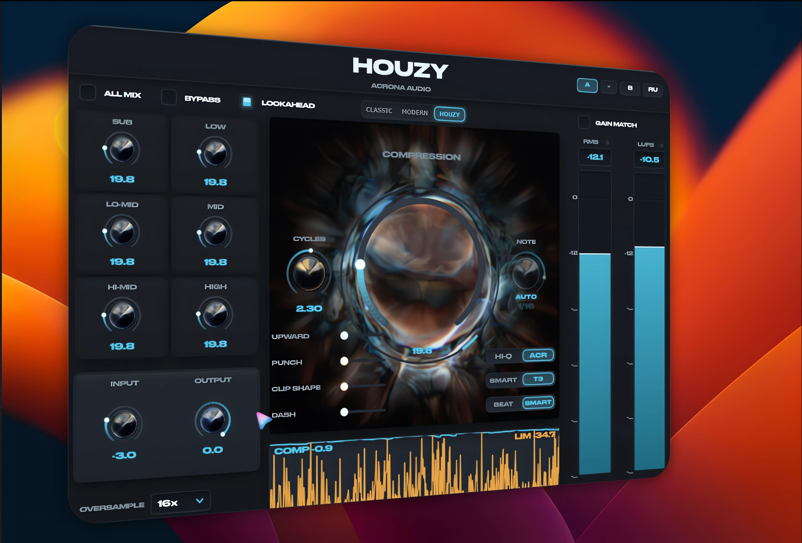

<div align="center">

**English** · [Русский](README.ru.md)

# HOUZY

<sup>**v5.2.0** · 9 November 2026</sup>

**One mastering compressor for every kind of music**

Four original technologies: **HOUZY** — compresses every tone on its own, with no shared gain and no pumping,
**ACR** — a clipper that cancels peaks instead of slicing them, so the punch stays,
**T8** — a limiter that moves gain only at zero crossings, so the bass and kick keep their shape,
**CYCLES / NOTE** — attack in wave cycles, release in fractions of a bar.

[]()
[]()
[]()
[]()

<br>

## ✦ HOUZY 5 is out

### [⬇ Download HOUZY 5 — acronaaudio.shop](https://acronaaudio.shop/download.html)

**[acronaaudio.shop](https://acronaaudio.shop)** · [Buy — $69](https://acronawar.gumroad.com/l/houzy) · [Try it in your browser](https://acronaaudio.shop/plugin.html)

HOUZY 5 is downloaded from our website. It comes with a **14-day free trial** with every
feature unlocked, then a one-time **$69** for a lifetime licence on two computers.

**Windows 10 / 11** (64-bit) · **macOS 10.15+** (Apple Silicon and Intel), VST3 and AU.

<br>



<sub>HOUZY — Liquid Glass design</sub>

</div>

### What's in HOUZY 5.2

- **HOUZY II, rebuilt** — the bands work as one team: the tone stays as it was, every range is
  evened out, the punch of every hit is kept, and the level no longer drifts
- **MIX & MASTER** — a catalogue of mixing and mastering engineers right inside the plugin:
  listen to their tracks, find your sound by style, talk in a live chat (voice messages,
  tracks, translation), or add your own profile
- **CLEAN L phase mode** — the clarity of LINEAR with a kick that hits more distinctly
- **A release that does what it says** — BEAT lets go in exactly the time you set, SMART lets go
  of fading sounds earlier
- **T6 | T8 limiter**, oversampling 8x by default and running only when there is something to cut
- **2.5 times lighter on the CPU** — from about 12 % of a core to under 5 %
- **Liquid Glass design** — translucent glass panels, a living liquid sphere in the centre that
  breathes with your music, five themes under **THEMES**, four sphere colours under **UI**
- **Meters you can trust** — RMS and LUFS to the broadcast standard (ITU-R BS.1770-4)
- **A manual inside the plugin** and an interface in **four languages** — English, Russian,
  Spanish and Portuguese
- **AMOUNT starts at 0** (HOUZY changes nothing until you ask), a bug report button in the plugin
- **macOS** — VST3 and AU, Universal (Apple Silicon and Intel)

### Coming in 5.3

- **New live themes** — FLURIK, WARPIK and AURORIK: the background moves behind the glass
- **A third limiter, T9** — T6, T8 or T9 on one switch. T9 limits the sub and the low band by
  their envelope, so the lowest octaves stay clean
- **The interface in seven languages** — Polish, Japanese and German join the four
- **UPWARD** reworked, **TRUE PEAK on by default**, and a cleaner HOUZY II chain

> **Using HOUZY 4.8?** The **UPDATE** badge in the plugin now opens the download page on
> our website. Your 4.8 keeps working as before, and your projects open in HOUZY 5.

<div align="center">

### [📖 User manual](https://acronaaudio.shop/manual.html)

<br>

---

## HOUZY 4.8 — the previous, free version

[]()
[]()

### [⬇ Windows · VST3](https://raw.githubusercontent.com/IACRONA/HOUZY/main/Releases/HOUZY-VST3-Windows.zip) · [⬇ Windows · installer](https://raw.githubusercontent.com/IACRONA/HOUZY/main/Releases/HOUZY-Windows-Installer.zip) · [⬇ macOS](https://raw.githubusercontent.com/IACRONA/HOUZY/main/Releases/HOUZY-Installer.pkg)

**Windows · VST3** — unzip and drop the `HOUZY.vst3` folder into `C:\Program Files\Common Files\VST3\`, then rescan plugins in your DAW.

**Windows · installer** — does the same thing for you.

**macOS** — the installer puts VST3 and AU where they belong. Or the bundles on their own: [VST3](https://raw.githubusercontent.com/IACRONA/HOUZY/main/Releases/HOUZY-macOS-VST3.zip) · [AU](https://raw.githubusercontent.com/IACRONA/HOUZY/main/Releases/HOUZY-macOS-AU.zip) — **AU** is the one Logic and GarageBand use.

> **The free macOS build is 4.7.0** — everything in it works; it just doesn't have the
> changes from 4.7.1 and 4.8.0.

> **A note on the installer.** It isn't code-signed, so Windows may show
> "Windows protected your PC" — click **More info → Run anyway**. Some scanners flag
> unsigned Inno Setup files by machine-learning guess, not because of anything inside.
> The plain zip above sidesteps this entirely: it holds the plugin folder and nothing
> executable.

### [📖 User manual for 4.8](MANUAL.md)
<sub>[Русский](MANUAL.ru.md) · [Español](MANUAL.es.md) · [Português](MANUAL.pt-BR.md)</sub>

<br>



<sub>HOUZY 4.8 — free, available above</sub>

</div>

---

## The problem

An ordinary compressor is `output = gain × signal`. **One number for the whole sound.**

Every classic complaint follows from that:

- **the detector is blind** — the entire spectrum is collapsed into one number, so a
  kick and a vocal of the same amplitude are indistinguishable to it;
- **the kick drags everything with it** — it is the loudest thing, the gain drops,
  and the hats, the vocal and the reverb tails dive with it. That is pumping;
- **attack fights punch** — one envelope has to serve both the transient and the body;
- **the bass gets dirty** — multiplication is modulation: the gain moves, and sidebands
  grow around a 50 Hz kick. The compressor ruins the very thing it was evening out.

Multiband does not fix this. It gives you a few numbers instead of one, but each is
still a single number for an entire band.

---

## HOUZY — even compression across every frequency in the track

The sound is taken apart into **individual tones**, and each one's loudness is evened
out by its own envelope. **Loud sounds don't drag the rest down, and the compressor
compresses sounds equally steadily, regardless of how loud any frequency in the mix
is.** Say the track has a loud kick, low end or midrange — the compressor will squeeze
the lows and the highs just the same.

Worth knowing: **the threshold here is automatic** — it sets itself from the loudest
sound and moves along with the track. **The release is automatic too** (AUTO): the
plugin measures how fast the sounds in the track fade out and sets the time itself. The compressor analyses every part of the
track separately and compresses every tone — kick, drums or vocal — the same way,
regardless of its loudness. Then the level is raised back automatically (make-up gain),
which gives you a well and densely compressed track. The compressor can be used not
only on the master, but the CPU load will grow.

**What that buys you:**

| | |
|---|---|
| **Loud doesn't drag the rest down** | A loud kick or bass doesn't make the hats, vocal and highs dip. |
| **Lows and highs compressed the same** | Whatever is louder in the track — lows or mids — every frequency is compressed the same way. |
| **Automatic threshold** | The threshold sets itself from the loudest sound and moves along with the track. Every tone — kick, drums, vocal — is analysed separately. |
| **Automatic release** | AUTO measures how fast the sounds in the track fade out and sets the release time itself. |
| **A dense track right away** | After compression the level is raised back automatically, so the track comes out dense. |
| **Not just for mastering** | Use it on any track or bus, but the CPU load will be higher. |

There are two engines on the switch: **HOUZY** and **HOUZY II**, a newer, more advanced
core. In HOUZY II the bands work as one team, it watches the tonal balance over whole
sections of the track, listens a quarter of a second ahead, and guards the attack of every
hit. New windows start on HOUZY II; your old projects stay on the engine they were saved
with. The delay is the same in both, so switching never makes your DAW re-sync the track.

---

## CYCLES and NOTE / MS — attack and release, reinvented

The millisecond is a poor unit for attack, and not always the right one for release.
That follows from arithmetic, not taste.

### Attack in wave cycles, not milliseconds

**5 ms on a 50 Hz bass note is a quarter of its wave.** The gain moves inside a single
oscillation: that is no longer dynamics, it is modulation — and it is exactly where a
compressor dirties the low end.

**The same 5 ms on an 8 kHz hat is forty cycles.** An eternity.

One number physically cannot serve both. But in HOUZY every tone arrives **with its own
frequency**, so "one cycle" is a quantity we actually have. Attack is set in cycles and
turns itself into the right number of milliseconds at every frequency.

> One knob, one position: **45 ms at 50 Hz and 1 ms at 8 kHz.**
> The attack is **never faster than half a cycle** of the tone — the bass cannot be
> modulated at all, and that is guaranteed by the design rather than by careful setting.

The knob is labelled **CYCLES**.

### Release in beat fractions — or in milliseconds

A release dialled in at 128 BPM is wrong at 124: the beat has moved, the milliseconds
have not. So the release has **two units**, switched by **clicking the label** above
the knob:

- **NOTE** — a fraction of a bar. **HOUZY takes the tempo from your project settings**
  (the host reports the number you set rather than guessing it from the audio), so the
  release stays on the beat when the tempo changes. Any tempo works;
- **MS** — plain milliseconds, 20…1200, continuously. **This is the default.**

### AUTO — the plugin sets the time itself

On by default. The plugin measures how fast the sounds in the track actually fade out
and uses that time. That is a measurement, not a guess — how fast a sound fades is a fact about the
audio, unlike the shape of an attack, which is a matter of taste. That is why ATTACK
deliberately has no such button.

In **MS** it is more precise: the measured time is used as is, while in NOTE it has to
be rounded to the nearest beat fraction. While AUTO is on, the knob shows the time it
picked.

### BEAT | SMART

A switch sits under the release knob:

- **BEAT** — lets go in exactly the time you set. **Default.**
- **SMART** — that release as a **maximum**: a tone that has already died away is let
  go early instead of holding an empty pause. You hear it on a skipped kick and on
  syncopation.

---

## ACR — a clipper that stops chopping the highs

An ordinary clipper **slices** the top off the waveform. A slice is an abrupt event, and
its error is broadband. So every kick hit subtracts that error from everything riding on
top of it: the hats, the vocal, the reverb tails.

Hence the classic problem with clipped house: **the harder you drive the kick, the
duller and grittier the top end gets.**

**Oversampling does not fix this.** 16x makes the error clean, but it does not change
*where* the error sits in the spectrum.

**Instead of slicing, ACR subtracts a short pulse** placed exactly at the peak. The
pulse's spectrum is shaped so the distortion lands in the top of the spectrum, where
the hats and the attack of the kick mask it.

The technique is borrowed from mobile network transmitters, where it is applied to LTE
signals, and the pulse kernel is designed from a psychoacoustic model of hearing.

ACR is the default. **HI-Q** — a conventional oversampled clipper — is the other
position of the switch.

---

## What else is in there

- **AUTO GAIN** (on by default) — measures how much the compression took and gives back
  exactly that, so the output stays as loud as the input. Switch it off and nothing is
  added back: you set the level with INPUT
- **Spectral limiter** — T6 (6 bands) or T8 (half-wave, the default), so a peak in the bass
  does not duck the highs. In 5.3 a third one joins: **T9**
- **Phase** — LINEAR, NATURAL or **CLEAN L** (the clarity of LINEAR with a more distinct kick)
- **MIX & MASTER** — a catalogue of mixing and mastering engineers with their tracks and a
  live chat, inside the plugin
- **GAIN MATCH** — matches the output to the input level so **BYPASS compares character
  rather than loudness**. Without it the plugin is always louder, and "better" just
  means "louder"
- **DASH** — one knob takes the compressor from punchy to even
- **UPWARD** — upward compression: lifts the quiet parts — reverb tails, air, detail
- **CLIP SHAPE** — a light saturation across the whole spectrum with automatic level
  compensation
- **ALL MIX** — 6 bands (SUB · LOW · LO-MID · MID · HI-MID · HIGH) with their own
  compression knobs and their own level (−6…+6 dB) feeding each band
- **TP** — true peak on the OUTPUT knob, for the final export to streaming and MP3
- **PRESETS** — DEFAULT, SNOOZE, SMOOTH, SMOOTHIE, SUSHI, SQUISHY, from gentle to dense. The
  list stays open so you can click through and compare by ear
- **A / B** — two settings slots, compared at matched loudness
- **Oversampling 4x…64x** (8x by default, and it runs only when the safety clipper has
  something to cut), **LOOKAHEAD** for the limiter
- **Meters** — RMS and LUFS, a gain-reduction graph per stage and a live waveform
- **English, Russian, Spanish and Portuguese** interface (HOUZY 5; 4.8 has English and
  Russian), language follows the system on first run. Polish, Japanese and German in 5.3
- **Update check** — a small UPDATE badge lights up when a new version is out; it can be
  switched off in the ACRONA AUDIO card

> HOUZY looks ahead, so it delays the sound by about 0.39 s (at 48 kHz). Your DAW
> compensates this automatically, and the delay never changes while you play. It is meant
> for mastering and mixing, not for live monitoring.

---

## Installing

**Windows** — run `HOUZY-Setup.exe` from the installer zip.
The plugin lands in `C:\Program Files\Common Files\VST3`.

**macOS** — download `HOUZY-Installer.pkg`, double-click it, and tick the formats
you want. The installer puts them where they belong.

> **The system will block the package on first launch** — it is not signed with an Apple
> certificate yet, and macOS quarantines anything unsigned. Get past it with
> **right-click the file → Open → Open** again in the warning. Or: System Settings →
> Privacy & Security → "Open Anyway" at the bottom.
>
> Nothing is broken and nothing is infected — macOS treats every unsigned installer
> this way.

Both Mac formats are Universal — Apple Silicon and Intel alike.
**AU** is the one Logic and GarageBand use, **VST3** is for everything else.

<details>
<summary>Install by hand, without the installer</summary>

Download the zip for the format your DAW uses, unpack it, and drag the bundle into the
matching folder:

| format | put it in | used by |
|---|---|---|
| `HOUZY.vst3` | `/Library/Audio/Plug-Ins/VST3/` | Ableton, Reaper, Cubase, Bitwig, FL |
| `HOUZY.component` | `/Library/Audio/Plug-Ins/Components/` | Logic Pro, GarageBand |

Installing by hand leaves the quarantine flag on, so clear it in Terminal — only the
line for the format you actually installed:

```bash
xattr -dr com.apple.quarantine /Library/Audio/Plug-Ins/VST3/HOUZY.vst3
xattr -dr com.apple.quarantine /Library/Audio/Plug-Ins/Components/HOUZY.component
```

Then restart your DAW and rescan.

</details>

**Close your DAW before installing or updating** — a running DAW keeps the plugin file
locked.

---

## What's new

## v5.2.0 · 9 November 2026

- **HOUZY II rebuilt** — the bands work as one team, the tone stays as it was, every range is
  evened out, the punch of every hit is kept, the level no longer drifts
- **New CLEAN L phase mode** — the clarity of LINEAR with a kick that hits more distinctly
- **BEAT releases in exactly the time you set**, SMART lets go of fading sounds earlier;
  BEAT is the default
- **2.5 times lighter on the CPU** — from about 12 % of a core to under 5 %
- **MIX & MASTER** — a catalogue of mixing and mastering engineers inside the plugin, with
  their tracks and a live chat
- **Limiter T6 | T8**, oversampling 8x by default, presets re-tuned, AMOUNT starts at 0,
  a bug report button. [Full article](https://acronaaudio.shop/houzy-5-2.html)

## v5.1.0 · 2 November 2026

- **HOUZY II** — a new, more advanced core. New windows start on it
- **ALL MIX repaired** — each knob works on its own band, no jump on the first nudge,
  a preset leaves no bands from the previous one
- **DELTA and GAIN MATCH are more accurate.** AUTO GAIN now returns only what the
  compression took (old projects play quieter: raise INPUT)
- **CLASSIC, MODERN and CHARACTER are gone** — every project opens in HOUZY
- New preset DEFAULT, a tidier ACRONA AUDIO card

## v5.0.1 · 20 October 2026

- **HOUZY is now on macOS** — VST3 and AU, Apple Silicon and Intel
- **A licence key entered in one plugin window now reaches all open windows at once**
- **Entering a new key frees the computer slot of the old one**

## v5.0.0 · 17 October 2026

- **A completely new Liquid Glass design**, five themes and four colours of the sphere
- **T8 limiter** — the bass and the kick are lowered without changing the shape of their wave
- **About a third less CPU**, a manual inside the plugin, the interface in four languages
- **HOUZY 5 is a paid release with a 14-day free trial** — download it at
  [acronaaudio.shop](https://acronaaudio.shop/download.html)

## v4.8.0 · 27 September 2026

- **AUTO GAIN now really gives back what HOUZY takes.** In HOUZY mode it saw no loss
  and returned almost nothing. **HOUZY can therefore play louder in projects you
  already have** — up to about 2 dB at the default setting on an open mix. If you
  liked it where it was, pull OUTPUT down to match
- **New TP button on the OUTPUT knob — true peak** for the final export
- **No more clicks and gaps when switching modes,** and turning COMPRESSION while
  playing no longer jumps
- **No more crunch or kick clicks on a hot track** — the clipper now takes only the
  short peaks at the very top and the limiter takes the bass and the body of the kick
- **The low end is back at CLIP SHAPE 0,** crash fix for hosts sending bigger chunks
  than announced, and nearly half the CPU of 4.7.1

---

<div align="center">

**ACRONA AUDIO**

</div>
